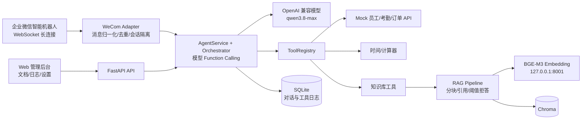
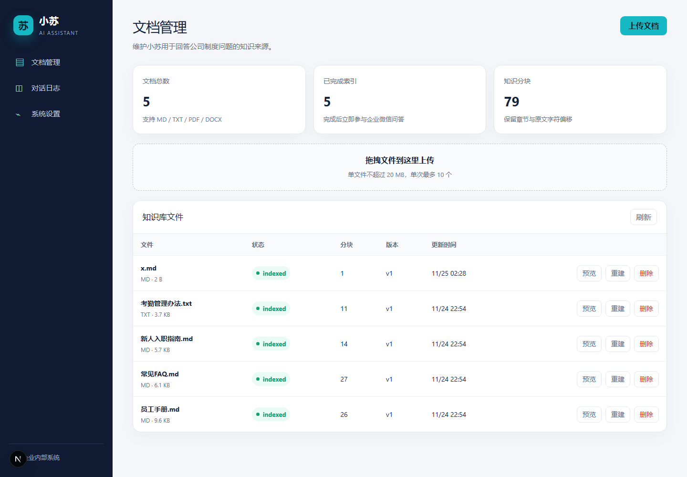
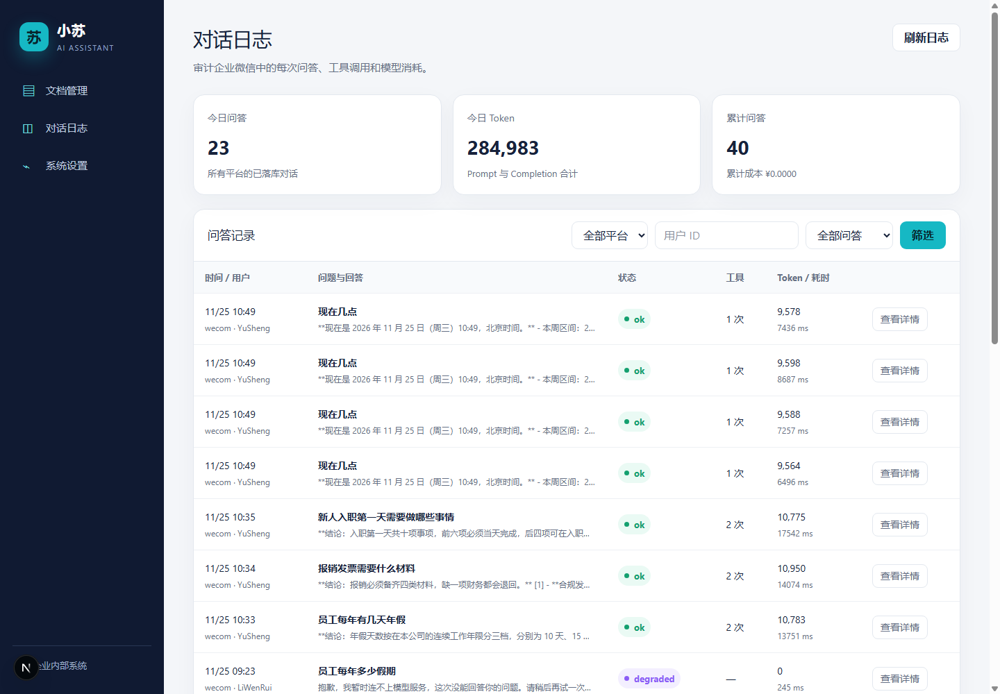
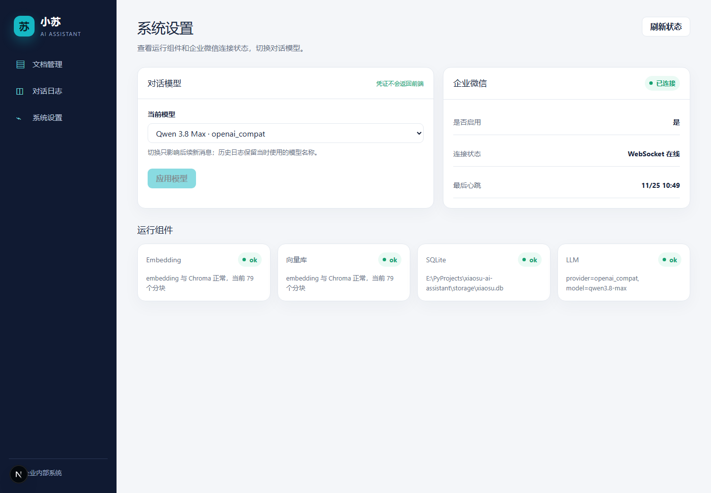
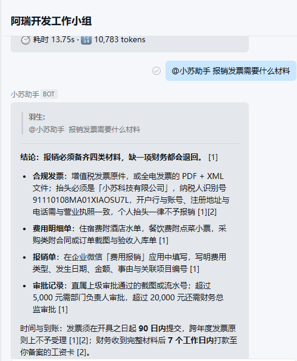
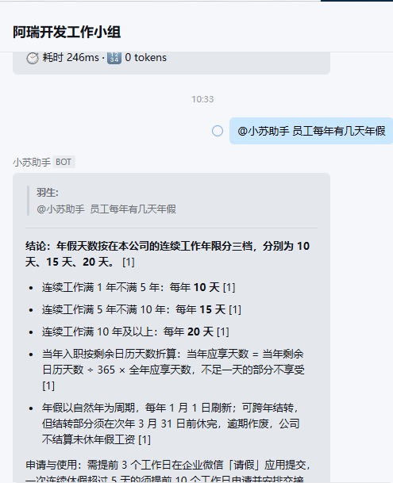
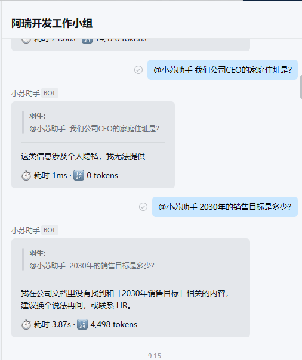

# 小苏 · 公司内部 AI 助手

> 一个**跑在企业微信里**的公司内部 AI 助手：员工 @小苏 提问，它自己决定查知识库、
> 查内部系统还是算数，给出**带原文引用**的答案，答不上来就老实说不知道。

**当前状态：**后端、RAG/文档管理、Function Calling、企业微信长连接和 Web 管理页已实现；
自动化与人工验收正在收口。企微实测见 [`docs/验收记录.md`](docs/验收记录.md)。

## 架构概览



端口与职责：后端 `8010`、前端 `3001`、本地 BGE-M3 服务 `8001`。企业微信和 Web 入口共用
`AgentService`，工具选择由模型 Function Calling 完成；只有知识库来源的答案执行 `[n]` 引用校验。

---

## 这个项目解决什么问题

公司内部知识散落在员工手册、报销制度、FAQ 里，员工找信息靠翻文档或问 HR；
考勤、订单等内部系统数据又要登录不同后台才能查。

小苏把这些统一到一个**员工本来就在用的 IM 入口**（企业微信）后面：

- 问「年假有几天」→ 检索知识库，给出答案 **+ 可点击跳转到原文那一行的引用**
- 问「员工 001 上周来了几天」→ 模型**自己决定**调考勤接口、调计算器
- 问「CEO 家庭住址」→ 三层拒答机制挡住，不编造
- 模型服务挂了 → 友好兜底话术，不转圈、不静默

面向两类人：**员工**（企业微信提问）与**管理员**（Web 后台传文档、看日志、切模型）。

---

## 技术栈

| 层次 | 选型 | 版本 | 说明 |
|---|---|---|---|
| 语言 | Python | 3.12 | 后端 |
| 依赖管理 | **uv** | ≥0.12 | 题目硬性要求 |
| Web 框架 | FastAPI + uvicorn | ≥0.115 | 原生 async、自动 OpenAPI |
| 数据校验 | Pydantic v2 + pydantic-settings | ≥2.9 | 强类型配置，启动即校验 |
| LLM 接入 | `openai` SDK（OpenAI 兼容协议） | ≥1.54 | 一套代码切换 qwen / deepseek / glm |
| 默认模型 | `qwen3.8-max`（阿里云 MaaS token-plan） | — | 同 key 可切 4 个模型 |
| Embedding | **本地 BGE-M3 独立服务**（1024 维） | — | 完全离线，见 `backend/dev_tools/` |
| 向量库 | ChromaDB（cosine 空间） | ≥0.5 | 支持按 `doc_id` 删除分块 |
| 关系库 | SQLite（WAL 模式） | stdlib | 零部署 |
| 前端 | **Next.js 15 App Router** + React 19 + Tailwind 4 + shadcn/ui | ≥15.4 | 题目版本底线 |
| 前端包管理 | **pnpm** | ≥11 | 题目硬性要求 |
| IM | **企业微信「智能机器人」WebSocket 长连接** | `wecom-aibot-sdk-python` | 出向连接，**无需公网 IP** |
| 测试 | pytest + pytest-asyncio + httpx + pytest-socket | — | MockLLM + 禁网，断网可跑 |
| 容器 | Docker + compose | — | M10 |

> 🔴 **未使用 LangChain / LlamaIndex**。RAG 管道（加载 → 分块 → 向量化 → 检索 → 引用定位）
> 全部自研，原因是题目要求「引用能定位到原文精确位置」，而框架的 `TextSplitter`
> 默认丢弃字符偏移量。详见 TDD §1.2 ①。

---

## 目录结构

```
xiaosu-ai-assistant/
├── backend/
│   ├── app/               # 运行时代码：api / core / llm / rag / agent /
│   │                      #            tools / im / services / db / schemas / mock_api
│   ├── dev_tools/         # 开发期工具，不进运行时（embedding 服务、语料生成、spike）
│   └── tests/             # unit / integration / e2e 三层
├── frontend/              # Next.js 15（M8 引入）
├── data/
│   ├── knowledge/         # 7 篇初始知识库语料
│   └── mock/              # 员工 / 考勤 / 订单 mock 数据
├── scripts/               # 8 个统一命令入口（已达上限，见下方工程规范）
├── docs/                  # PRD / TDD / DEV_PLAN / ACCEPTANCE / ai_journal
│   └── screenshots/       # 截图与录屏
├── evals/                 # 自动化评测（M11 引入）
├── logs/                  # 运行时日志（不入库）
├── .env.example           # 全量配置项 + 中文注释
├── .gitattributes         # 锁定 .sh 为 LF（Windows 下必需）
└── .gitignore
```

分层依赖是**单向**的，`api/` 与 `im/` 平级且都只调 `services/` —— 这是
「企业微信和 Web 复用同一套问答逻辑」的**结构性保证**，不是口头承诺（TDD §3.1）。

---

## 快速开始

端口通过 `.env` 外置配置；默认后端为 8010、前端为 3001、Embedding 为 8001。
不要为本项目抢占其他服务正在使用的 8000/3000。

**前置依赖**：Python 3.12、uv、Node 22、pnpm、Git Bash（Windows 跑 `scripts/*.sh`）；
Windows 也可直接用 PowerShell 的 `scripts/start.ps1`。

```bash
git clone https://github.com/Lwr99204/xiaosu-ai-assistant.git
cd xiaosu-ai-assistant
cp .env.example .env          # 填入 LLM_API_KEY
bash scripts/setup.sh         # 装依赖 + 建库 + 装 Git 钩子
bash scripts/start.sh         # 起后端 :8010 + 前端 :3001 + IM 长连接
```

Windows PowerShell 中初始化（显式调用 Git for Windows 自带 Bash，避免 `bash` 被解析到 WSL）：

```powershell
$gitCmd = (Get-Command git).Source
$gitRoot = Split-Path (Split-Path $gitCmd -Parent) -Parent
& (Join-Path $gitRoot 'bin\bash.exe') scripts/setup.sh
```

初始化完成后，Windows PowerShell 启停：

```powershell
.\scripts\start.ps1 -NoPause
.\scripts\start.ps1 -Stop
```

**RAG 需要本地 BGE-M3 模型权重**（M3 起为硬依赖）。权重不入库；在新电脑上
按 [`backend/dev_tools/README.md`](backend/dev_tools/README.md) 创建一次独立运行环境，
并在 `.env` 填好 `BGE_MODEL_DIR`。之后一键启动会自动检查并拉起 Embedding 服务，
无需另开终端。

```bash
curl -s http://127.0.0.1:8001/health
# {"status":"ok","model":"bge-m3","loaded":true,"dimension":1024,...}
```

模型权重（约 2.2 GB）不入库，获取方式见 [`backend/dev_tools/README.md`](backend/dev_tools/README.md)。

**企业微信智能机器人**（M9）：需在企业管理后台创建「智能机器人」拿到 `bot_id` + `secret`，
填入 `.env` 的 `WECOM_BOT_ID` / `WECOM_BOT_SECRET`，并把 `WECOM_ENABLED` 设为 `true`。
凭证未就绪时保持 `false`，项目其余部分照常运行。

---

## 常用命令

| 命令 | 作用 | 当前状态 |
|---|---|---|
| `bash scripts/setup.sh` | 初始化依赖与本地数据 | 可用，按目标机环境执行 |
| `bash scripts/start.sh` | 启动后端与前端；先确认 embedding 健康 | 可用 |
| `bash scripts/stop.sh` | 停止脚本记录的项目进程 | 可用；Windows 推荐 PowerShell 脚本 |
| `bash scripts/test.sh` | Ruff、pytest、规模门禁、前端检查 | 可用 |
| `bash scripts/lint.sh` | 风格、类型与 `.sh` 行尾检查 | 可用 |
| `bash scripts/check_limits.sh` | **≤500 行 / ≤8 文件 门禁** | ✅ **已完整实现** |
| `bash scripts/seed_data.sh` | 生成并导入语料与 mock 数据 | 🚧 骨架（M2 起） |
| `bash scripts/acceptance_check.sh` | API、文档链路与 MockLLM 回归验收 | 可用；真机项目仍须人工执行 |

---

## 工程规范（合规底线）

两条硬约束：**单文件 ≤500 行**、**单目录 ≤8 个文件**。由 `scripts/check_limits.sh`
自动校验，并挂在 pre-commit 钩子上。三条统计口径必须说清，否则评审会有歧义：

1. **只数目录的直接子文件**，子目录不计入。
2. **只统计代码文件**（`.py` / `.ts` / `.tsx` / `.js` / `.jsx`）。截图、录屏、`.md` 语料、
   `.pdf` / `.docx` 等资源与文档**不计入** —— 否则 `docs/screenshots/` 放十几张验收截图就误报。
   同理，`__init__.py` 与 `.gitkeep` 不计入目录文件数，但 `__init__.py` **仍受 500 行约束**。
3. **仓库根目录交付文件共 5 个**：`.env.example`、`.gitignore`、`.gitattributes`、
   `README.md`、`AI_USAGE.md`。自评和验收记录位于 `docs/`。`backend/`、`frontend/`、`scripts/`、`data/`、
   `docs/`、`evals/`、`logs/` 都是**目录**，不计入。

⚠️ `scripts/`（8 个）与 `backend/tests/unit/`（8 个）**已达上限**，后续新增必须先建子目录。

**密钥安全**（FR-6-04 是淘汰项）：`.env` 已被 `.gitignore` 忽略；pre-commit 钩子会扫描
暂存内容，命中 `sk-` 开头的真实 key 或「密钥名 = 像真密钥的长值」时**直接拒绝提交**，
且报错信息对密钥做脱敏（只显示首 4 末 2 位）。

---

## Roadmap

> 🔁 权威开发顺序以 [docs/CURRENT_PLAN.md](docs/CURRENT_PLAN.md) 为准（Gate 0 + M1~M6，
> IM 集成提前、RAG 后置）。下表保留原 DEV_PLAN 的 M0~M12 编号供查阅历史任务拆解，
> 两套编号不一一对应，进度以 CURRENT_PLAN 为准。

| 里程碑 | 内容 | 状态 |
|---|---|---|
| Gate 0 | 企业微信长连接风险验证 | ✅ 完成 |
| M1–M3 | 后端、Mock API、工具 Agent、会话与企微主链路 | ✅ 实现完成；10 道真机业务题 10/10 通过，用户确认两项边界题通过 |
| M4 | RAG 与文档管理 | ✅ 实现完成；引用回归修复，三道知识库题复测通过 |
| M5 | Web 管理后台 | ✅ 核心页面完成；三页截图已收录 |
| M6 | 工程化与交付 | ✅ 自动验收 9 项通过；315 项测试、代码质量检查、交付文档和 29.2 秒演示视频已完成 |
| 克隆复现 | 新环境初始化 | ⚠️ 克隆和 README 检查完成；离线安装因缓存缺少 `numpy` 中止，完整依赖安装/启动尚未验证 |
| M11 | 多模型评测、Evals、第二 IM 等加分项 | ⏸ 本次交付范围外 |

执行基线和人工验收记录见 [`docs/CURRENT_PLAN.md`](docs/CURRENT_PLAN.md) 与 [`docs/验收记录.md`](docs/验收记录.md)。

---

## 文档索引

| 文档 | 内容 |
|---|---|
| [`docs/PRD.md`](docs/PRD.md) | 做什么、做到什么程度（FR / NFR / 验收清单 / 评分映射） |
| [`docs/TDD.md`](docs/TDD.md) | 怎么做（选型 / 架构 / 模块设计 / API 契约 / 测试策略 / ADR） |
| [`docs/DEV_PLAN.md`](docs/DEV_PLAN.md) | 按什么顺序做、每步交付什么、怎么提交 |
| [`backend/dev_tools/README.md`](backend/dev_tools/README.md) | 开发期工具与本地 embedding 服务 |
| `AI_USAGE.md` | AI 使用方式与踩坑复盘（M12 交付，素材见 `docs/ai_journal.md`） |
| [`docs/自评.md`](docs/自评.md) | 对照考题的自评、扣分点与取舍（M12 交付） |

## 验收截图

Web 管理后台与企业微信真机问答截图如下；29.2 秒真实操作录屏已附上，详见
[`docs/screenshots/README.md`](docs/screenshots/README.md)。企微截图为真实客户端原图。

### 文档管理



### 对话日志



### 系统设置



### 企业微信真机问答







[查看 29.2 秒真实操作演示视频](docs/screenshots/demo-30s.mp4)
